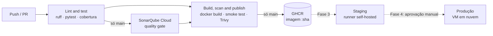

# CI/CD Lab — guia de replicação

Laboratório prático de um pipeline CI/CD completo: código → testes → qualidade → artefato → deploy.
Este guia registra a stack, as decisões, os passos e os comandos para refazer o lab do zero.

| Item | Valor |
|---|---|
| Repositório | `github.com/chcb1/cicd-lab` (público) |
| Aplicação | Task API — FastAPI (Python 3.13), deliberadamente simples |
| Máquina do lab | Ubuntu 22.04 (ThinkPad X230) |
| Status | Fase 1 concluída · Fase 2 em andamento |

---

## 1. Stack

| Etapa | Ferramenta | Papel | Custo / limite |
|---|---|---|---|
| Código e CI | GitHub + GitHub Actions | Repositório, PRs, execução do pipeline | Grátis em repo público (runners hospedados) |
| Lint e formatação | Ruff | Padrão de código | Open source |
| Testes | pytest + pytest-cov | Testes unitários e cobertura (mínimo 80%) | Open source |
| Qualidade | SonarQube Cloud | Análise estática e quality gate | Plano Free: só a branch `main` |
| Segurança | Trivy (via `trivy-action`) | Scan de vulnerabilidades da imagem | Open source |
| Artefato | Docker + GHCR | Imagem versionada pelo SHA do commit | Grátis para pacotes públicos |
| Deploy (Fase 3) | Runner self-hosted + Docker Compose | Staging na máquina do lab | Open source |
| Produção (Fase 4) | VM em nuvem (DigitalOcean ou Oracle) | Destino de produção | Trial / Always Free |

Ferramentas avaliadas e adiadas estão no [registro de decisões](#9-registro-de-decisões).

## 2. Arquitetura do pipeline



Princípios aplicados:

- **Build once:** a imagem é construída uma vez, tagueada com o SHA do commit, e é essa mesma imagem que é testada, escaneada, publicada e promovida.
- **Só a `main` vira artefato:** PRs executam build e scan, mas não publicam.
- **Gates em ordem:** se lint ou testes falham, o build não roda (`needs: test`); se o quality gate ou o Trivy falham, nada é publicado.
- **Menor privilégio:** o workflow só lê o repositório; apenas o job de build recebe `packages: write`.
- **Actions fixadas por SHA:** tags de actions são mutáveis (ver o [incidente do Trivy](#incidente-de-supply-chain-do-trivy-março2026)).

## 3. Pré-requisitos

- Conta GitHub.
- Ubuntu com `git` e acesso à internet.
- Conta no SonarQube Cloud (login com o GitHub).

---

## 4. Fase 0 — Ambiente local

### 4.1 Git e identidade

```bash
git --version                                   # se faltar: sudo apt install -y git
git config --global user.name "Seu Nome"
git config --global user.email "email-verificado@no-github"
git config --global init.defaultBranch main
git config --list --show-origin                 # mostra de qual arquivo vem cada valor
```

- O e-mail precisa estar **verificado** em GitHub > Settings > Emails; caso contrário, os commits não são vinculados ao perfil.
- Em repositório público o e-mail fica visível no histórico. Alternativa: o endereço `noreply` da mesma tela.

### 4.2 GitHub CLI e autenticação

Instalar pelo repositório oficial do GitHub CLI. O pacote `gh` do apt padrão do Ubuntu 22.04 é antigo (2.4.x) e não tem várias opções usadas neste guia, como `gh run list --branch`.

```bash
(type -p wget >/dev/null || (sudo apt update && sudo apt install wget -y)) \
	&& sudo mkdir -p -m 755 /etc/apt/keyrings \
	&& out=$(mktemp) && wget -nv -O$out https://cli.github.com/packages/githubcli-archive-keyring.gpg \
	&& cat $out | sudo tee /etc/apt/keyrings/githubcli-archive-keyring.gpg > /dev/null \
	&& sudo chmod go+r /etc/apt/keyrings/githubcli-archive-keyring.gpg \
	&& sudo mkdir -p -m 755 /etc/apt/sources.list.d \
	&& echo "deb [arch=$(dpkg --print-architecture) signed-by=/etc/apt/keyrings/githubcli-archive-keyring.gpg] https://cli.github.com/packages stable main" | sudo tee /etc/apt/sources.list.d/github-cli.list > /dev/null \
	&& sudo apt update \
	&& sudo apt install gh -y
gh --version
```

```bash
gh auth login            # GitHub.com > HTTPS > autenticar o Git: Yes > web browser
gh auth status
gh api -i user | grep -i x-oauth-scopes   # confere os escopos do token
gh auth refresh -h github.com -s workflow # só se faltar o escopo "workflow"
```

O escopo `workflow` é obrigatório para enviar arquivos em `.github/workflows/`.

---

## 5. Fase 1 — Repositório, CI e proteção da main ✅

### 5.1 Projeto local e primeiro commit

```bash
mkdir -p ~/cicd-prj && cd ~/cicd-prj
unzip ~/Downloads/cicd-lab.zip && cd cicd-lab
ls -la                     # .github, .gitignore e .dockerignore são ocultos
git init -b main
git add .
git commit -m "Initial commit: Task API with CI"
git log -1 --format='%an <%ae>'   # valida autor e e-mail
git ls-files                      # o que está sendo versionado
```

### 5.2 Criar o repositório remoto

```bash
gh repo create cicd-lab --public --source=. --remote=origin --push
git remote -v
gh run list
gh run view <run-id> -v
```

### 5.3 Pipeline de CI (`.github/workflows/ci.yml`)

| Bloco | Função |
|---|---|
| `on: pull_request` / `push: branches: [main]` | Roda em todo PR e a cada merge na `main` |
| `permissions: contents: read` | Token do workflow somente leitura |
| `concurrency` | Push novo na mesma branch cancela a execução anterior |
| Job `Lint and test` | Ruff, pytest com cobertura mínima de 80% |
| Job `Build…` com `needs: test` | Só roda se os testes passarem; senão é *skipped* |

### 5.4 Proteção da branch main

**Via interface:** Settings > Branches > Add classic branch protection rule:

- Branch name pattern: `main`
- Require a pull request before merging (sem aprovações obrigatórias: dev solo)
- Require status checks to pass: os jobs do pipeline
- Do not allow bypassing the above settings
- **Clicar em Create no fim da página**

**Via API (configuração como código, recomendado):** a regra fica em [`ops/branch-protection.json`](../ops/branch-protection.json).

```bash
gh api -X PUT repos/chcb1/cicd-lab/branches/main/protection --input ops/branch-protection.json
```

**Verificação (sempre pela API, não pela tela):**

```bash
gh api repos/chcb1/cicd-lab/branches/main/protection   # 404 = sem regra clássica
gh api repos/chcb1/cicd-lab/rulesets                   # [] = sem rulesets
gh api graphql -f query='{ repository(owner:"chcb1", name:"cicd-lab") { branchProtectionRules(first:10) { nodes { pattern isAdminEnforced } } } }'
```

Campos a conferir: `required_pull_request_reviews` presente, checks em `required_status_checks`, `enforce_admins.enabled: true`.

> Proteção de branch em repositório **privado** exige GitHub Pro/Team. No plano Free, só funciona em repositório público.

### 5.5 Testes negativos do controle

Um controle só está provado quando a tentativa de violá-lo falha.

**(a) Push direto na main — deve ser recusado**

```bash
# alteração inofensiva no README.md
git add README.md && git commit -m "test: direct push to main" && git push
# esperado: GH006 Protected branch update failed / [remote rejected] main -> main
git switch -c test/protection      # leva o commit para uma branch
git switch main
git reset --hard origin/main       # destrutivo: só com o commit preservado na branch
git log --oneline --all --graph
git push -u origin test/protection
```

**(b) PR com teste quebrado — merge deve ser bloqueado**

```bash
# em app/main.py, health() retornando {"status": "up"}
git add app/main.py && git commit -m "test: break health endpoint on purpose" && git push
gh pr create --base main --head test/protection --title "Test branch protection" --body "Negative test"
gh run watch
gh pr merge --merge                # esperado: bloqueado por check obrigatório falhando
gh run view --log-failed           # lê só o log do que falhou
# corrigir de volta para "ok", commit, push, aguardar verde
gh pr merge --squash --delete-branch
git switch main && git pull
```

### 5.6 Fluxo de trabalho padrão

```
branch → commit → push → PR (pipeline roda) → checks verdes → squash merge → pull na main
```

---

## 6. Fase 2 — Qualidade, segurança e artefato 🚧

Objetivo: em todo merge na `main`, gerar uma imagem versionada que passou por testes, quality gate e scan de vulnerabilidades, e publicá-la no GHCR.

### 6.1 SonarQube Cloud

1. Entrar em sonarcloud.io com o GitHub e importar a organização/conta.
2. Analisar um novo projeto: `cicd-lab`.
3. No projeto: **Administration > Analysis Method**.
   - Desligar **Automatic Analysis**: ela conflita com a análise via CI.
   - Escolher **With GitHub Actions**. A tela de onboarding mostra o valor do `SONAR_TOKEN` (passo 1) e, ao escolher **Python** no passo 2, o conteúdo do `sonar-project.properties` com `sonar.organization` e `sonar.projectKey` já preenchidos.
   - A chave da organização no SonarQube Cloud pode ser diferente do usuário do GitHub (neste lab: `chcb`, não `chcb1`). Usar sempre o valor mostrado pelo Sonar.
   - **O token aparece em texto claro nessa tela:** não tirar print nem colar em chat, ticket ou documento. Se vazar, revogar em My Account > Access Tokens e gerar outro.
4. Se precisar de um token novo: menu da conta (canto superior direito) > **My Account > Access Tokens** > Personal Tokens. Definir uma expiração; quando o token expirar, o pipeline falha na etapa do Sonar até ser gerado outro e atualizado o segredo.
5. Guardar o token como segredo do repositório:

```bash
gh secret set SONAR_TOKEN     # cola o token quando pedir; ele não aparece na tela
gh secret list
```

6. Ajustar `sonar.organization` e `sonar.projectKey` em [`sonar-project.properties`](../sonar-project.properties) com os valores do tutorial. Alternativa: a URL do projeto contém `id=<projectKey>`, e a da organização contém `/organizations/<organizationKey>/`.

> No plano Free a análise vale só para a `main`, então o quality gate roda **depois** do merge. Se ele falhar, o job `Lint and test` falha e a imagem não é publicada. Os gates antes do merge são lint, testes e Trivy.

### 6.2 Mudanças nos arquivos

| Arquivo | Mudança |
|---|---|
| `sonar-project.properties` | Novo: organização, chave, fontes, testes, cobertura, `qualitygate.wait` |
| `Dockerfile` | `LABEL org.opencontainers.image.source` liga o pacote do GHCR ao repositório; `pip uninstall -y pip` remove o pip da imagem final (ver 6.5) |
| `.github/workflows/ci.yml` | Sonar no job de testes; job renomeado para `Build, scan and publish`, com Trivy e push ao GHCR |
| `ops/branch-protection.json` | Checks obrigatórios atualizados para o novo nome do job |

Pontos do `ci.yml`:

- `fetch-depth: 0` no checkout: o Sonar precisa do histórico para separar código novo do antigo.
- `IMAGE: ghcr.io/${{ github.repository }}`: o nome do pacote precisa ser minúsculo.
- `permissions: packages: write` só no job de build.
- Trivy com `severity: CRITICAL,HIGH`, `ignore-unfixed: true` e `exit-code: "1"`: falha só por vulnerabilidade grave que já tem correção.
- `if: github.event_name == 'push'` no Sonar, no login e no push: PRs constroem e escaneiam, mas não publicam.
- Login no GHCR com o `GITHUB_TOKEN` do próprio workflow, sem token pessoal.

### 6.3 Passos

```bash
git switch main && git pull
git switch -c feat/phase2-artifact
# aplicar as mudanças da tabela 6.2
git add .
git commit -m "feat: SonarQube quality gate, Trivy scan and GHCR publish"
git push -u origin feat/phase2-artifact
gh pr create --base main --title "Phase 2: quality gate, scan and artifact" --body "SonarQube Cloud, Trivy, GHCR"
gh run watch
```

**Renomear um job quebra a proteção de branch.** O check antigo (`Build image (no push yet)`) nunca mais reporta, e o PR fica eternamente em "Expected — Waiting for status". Atualizar a regra depois de os novos checks rodarem uma vez:

```bash
gh api -X PUT repos/chcb1/cicd-lab/branches/main/protection --input ops/branch-protection.json
gh pr merge --squash --delete-branch
git switch main && git pull
gh run watch                 # execução na main: Sonar + publicação
```

### 6.4 Verificação

- SonarQube Cloud: projeto com análise da `main` e quality gate "Passed".
- GitHub > repositório > Packages: `cicd-lab` com a tag igual ao SHA do commit de merge.
- Opcional, com Docker instalado: `docker pull ghcr.io/chcb1/cicd-lab:<sha>`.

### 6.5 Primeiro achado real do Trivy (2026-10-16)

O primeiro PR da Fase 2 foi reprovado com 4 vulnerabilidades HIGH:

| Pacote | Vulnerabilidade | Instalada | Corrigida |
|---|---|---|---|
| msgpack | GHSA-6v7p-g79w-8964 | 1.1.2 | 1.2.1 |
| setuptools | CVE-2025-47273 | 70.3.0 | 78.1.1 |
| urllib3 | CVE-2026-97687, CVE-2026-97689 | 2.7.0 | 2.8.0 |

Nenhum desses pacotes é dependência da aplicação. Os quatro estão **embutidos no próprio pip** (`pip/_vendor/vendor.txt` do pip 26.2.1, a versão mais recente na data), que vem na imagem base. Atualizar o pip não resolve, porque a versão nova ainda embute as mesmas versões.

Decisão: **remover o pip da imagem final** depois de instalar as dependências. O pip só é necessário para construir a imagem, não para rodar a aplicação. Remover a ferramenta de build reduz a superfície de ataque, e esse é o padrão de mercado.

Alternativa descartada: ignorar os CVEs em um `.trivyignore`. Seria aceitar o risco de algo que pode simplesmente ser removido.

Diagnóstico usado:

```bash
gh run list -L 5
gh run view <ID> --log-failed > trivy.log
grep -n -E "Total:|CVE-|GHSA-|ERROR|FATAL" trivy.log | head -40
```

### 6.6 Exercício: dependência vulnerável

Em uma branch, adicionar ao `requirements.txt` uma versão antiga com CVE conhecido (por exemplo `requests==2.19.0`), abrir o PR e confirmar que o Trivy reprova o build, listando o CVE e a versão corrigida. Depois remover e fechar o PR sem merge.

---

## 7. Fase 3 — Deploy em staging (planejado)

- Runner self-hosted na máquina do lab, com usuário dedicado.
- **Decisão pendente:** runner self-hosted em repositório público é arriscado; avaliar voltar o repositório para privado (com isso a proteção de branch deixa de ser aplicada no plano Free).
- Deploy da imagem `:sha` do GHCR com Docker Compose, seguido de smoke test.
- Rollback: redeploy do SHA anterior.

## 8. Fase 4 — Promoção para produção (planejado)

- GitHub Environments `staging` e `production`, com aprovação manual em produção.
- A mesma imagem `:sha` promovida, sem rebuild.
- Destino: VM em nuvem (DigitalOcean com crédito de trial, ou Oracle Always Free). Criar a conta só ao chegar nesta fase e configurar alerta de orçamento no primeiro dia.

---

## 9. Registro de decisões

| Data | Decisão | Motivo |
|---|---|---|
| 2026-10-06 | Python/FastAPI como app | Build rápido e imagem pequena; o foco é o pipeline |
| 2026-10-06 | SonarQube Cloud em vez de self-hosted | Self-hosted consome de 2 a 4 GB de RAM da máquina do lab e ensina a operar Sonar, não pipeline |
| 2026-10-06 | GHCR como repositório de artefatos | Sem servidor extra; Nexus/Artifactory pesam na máquina |
| 2026-10-06 | Repositório público | Proteção de branch no plano Free só funciona em repo público |
| 2026-10-09 | JFrog (JCR/Xray) adiada | Xray só tem trial de 14 dias; a JCR é auto-hospedada e pesada, e exigiria antecipar o runner e tornar o repo privado. Para conhecer: Platform Tour ou trial isolado |
| 2026-10-09 | Trivy mantido, fixado por SHA (v0.36.0) | Ver incidente de março/2026 abaixo |
| 2026-10-16 | Remover o pip da imagem final | CVEs HIGH em dependências embutidas no pip; ferramenta de build não pertence à imagem de execução (seção 6.5) |

## 10. Troubleshooting

| Sintoma | Causa | Correção |
|---|---|---|
| `mv: cannot move ... to '/pasta': Permission denied` | `/pasta` é a raiz do sistema | Usar `~/pasta`; não usar `sudo` para trabalho de projeto |
| `.github` ficou para trás ao mover arquivos | O glob `*` não inclui arquivos ocultos | `ls -la`; mover os ocultos explicitamente |
| `gh auth status` não mostra os escopos | `gh` antiga do apt (Ubuntu 22.04) | `gh api -i user \| grep -i x-oauth-scopes`, ou atualizar a `gh` (seção 4.2) |
| `unknown flag: --branch` no `gh run list` | `gh` antiga do apt (2.4.x) | Atualizar a `gh` pelo repositório oficial (seção 4.2) |
| Trivy reprova `urllib3`/`msgpack`/`setuptools` que a app não usa | Pacotes embutidos no pip da imagem base | Remover o pip da imagem final (seção 6.5) |
| `run or job ID required when not running interactively` | Saída redirecionada (`>`) desliga o menu interativo | Passar o ID: `gh run list -L 5`, depois `gh run view <ID> --log-failed` |
| Push recusado mencionando `workflow` scope | Token sem o escopo `workflow` | `gh auth refresh -h github.com -s workflow` |
| Push direto na `main` aceito apesar da "proteção" | A regra não foi salva | Verificar pela API (5.4); salvar com Create ou aplicar via `gh api` |
| PR preso em "Expected — Waiting for status" | Check obrigatório com nome de job que não existe mais | Atualizar `ops/branch-protection.json` e aplicar via `gh api` |
| Sonar: erro de análise automática ativa | Análise automática e via CI ao mesmo tempo | Desativar Automatic Analysis no projeto |
| Caminhos do Sonar diferentes da documentação antiga | Interface renomeada (Security → Access Tokens) | Usar Administration > Analysis Method > With GitHub Actions, que mostra token e chaves |
| Etapa do Sonar falha com erro de autenticação depois de semanas | Token pessoal expirou | Gerar novo token e rodar `gh secret set SONAR_TOKEN` |
| Token exposto em print, chat ou log | Segredo vazado | Revogar imediatamente, gerar outro e atualizar o segredo. Vazou = comprometido, mesmo que "ninguém tenha visto" |
| Sonar: "project not found" ou organização inválida | `sonar.organization` com o usuário do GitHub em vez da chave do Sonar | Copiar organização e chave do onboarding (opção Python) |
| `remote rejected ... protected branch hook declined` | Regra do servidor, não erro local | Seguir o fluxo por PR |

### Incidente de supply chain do Trivy (março/2026)

Em 19/03/2026 o binário Trivy v0.69.4 foi publicado com código malicioso, e quase todas as tags de `aquasecurity/trivy-action` e `setup-trivy` foram redirecionadas para commits que roubavam segredos dos runners. Quem referenciava a action por **tag** executou o código do atacante; quem fixava por **SHA completo** não foi afetado. Recomendação da Aqua: fixar actions pelo SHA completo do commit e não confiar em tags. Por isso todas as actions deste lab usam `@<sha> # vX.Y.Z`.

Para obter o SHA de uma versão (em tags anotadas, usar a linha `^{}`, que é o commit):

```bash
git ls-remote --tags https://github.com/aquasecurity/trivy-action | grep 'v0.36.0'
```

---

## 11. Referência rápida

| Comando | Para quê |
|---|---|
| `git status` | Estado das três áreas (pasta, staging, repositório) |
| `git switch -c <branch>` | Criar branch e trocar para ela |
| `git push -u origin <branch>` | Publicar a branch e ligá-la à remota |
| `git pull` | `fetch` + `merge` da remota |
| `git log --oneline --all --graph` | Histórico de todas as branches em grafo |
| `git revert <sha>` | Desfazer um commit já publicado sem reescrever história |
| `gh pr create / merge / checks` | Ciclo de PR pela linha de comando |
| `gh run list / watch / view --log-failed` | Acompanhar e diagnosticar o pipeline |
| `gh secret set <NOME>` | Guardar um segredo no repositório |
| `gh api <endpoint>` | Consultar ou configurar o GitHub pela API |

## 12. Equivalências GitHub → Azure DevOps

| GitHub | Azure DevOps |
|---|---|
| Workflow (`.github/workflows/*.yml`) | Pipeline YAML (`azure-pipelines.yml`) |
| Job / step | Job / step (ou task) |
| `needs:` | `dependsOn:` |
| `on: push / pull_request` | `trigger:` / `pr:` (no Azure Repos, a validação de PR vem da branch policy) |
| Runner hospedado / self-hosted | Microsoft-hosted agent / self-hosted agent |
| Branch protection + required checks | Branch policies + build validation |
| Repository secrets | Pipeline variables (secret) / variable groups |
| GHCR | Azure Artifacts / Azure Container Registry |
| Environments com aprovação | Environments com approvals and checks |

## 13. Alternativa visual: VS Code e GitHub web

O lab pode ser feito com o VS Code (edição e Git) e a interface web do GitHub (PRs, pipeline, configurações) no lugar do `nano` e de boa parte da `gh`.

### 13.1 VS Code conectado à máquina do lab (Remote - SSH)

O VS Code roda no notebook e edita os arquivos diretamente na máquina do lab. O terminal integrado também roda lá.

Na máquina do lab (uma vez):

```bash
sudo apt install -y openssh-server
sudo systemctl enable --now ssh
sudo ufw allow in on tailscale0 to any port 22   # SSH só pela rede do Tailscale
```

No notebook: instalar o VS Code e a extensão **Remote - SSH** (Microsoft). Depois `Cmd+Shift+P` > **Remote-SSH: Connect to Host** > `usuario@host-da-maquina`, e **File > Open Folder** > pasta do projeto. Extensão opcional: **GitHub Pull Requests** (PRs e checks dentro do VS Code).

### 13.2 Equivalências

| Tarefa | Linha de comando | VS Code | GitHub web |
|---|---|---|---|
| Editar arquivo | `nano` | Explorer > abrir o arquivo | Ícone de lápis (cria commit na branch) |
| Copiar arquivo do notebook para o projeto | `cp` / `unzip` | Arrastar do Finder para o Explorer | Add file > Upload files |
| Ver branch atual | `git status` | Barra inferior esquerda | — |
| Criar ou trocar de branch | `git switch -c` / `git switch` | Clicar no nome da branch na barra inferior | — |
| Revisar mudanças | `git diff` | Source Control > clicar no arquivo (diff lado a lado) | Aba Files changed do PR |
| Stage, commit e push | `git add` / `commit` / `push` | Source Control: `+`, mensagem, Commit, Sync Changes | — |
| Atualizar a `main` local | `git pull` | Sync Changes | — |
| Limpar referências remotas | `git fetch --prune` | Source Control > `...` > Pull, Push > Fetch (Prune) | — |
| Abrir PR | `gh pr create` | Extensão GitHub Pull Requests | Banner Compare & pull request |
| Acompanhar pipeline | `gh run watch` | Extensão GitHub Pull Requests | Aba Checks do PR ou aba Actions |
| Ler log de falha | `gh run view <ID> --log-failed` | — | Actions > execução > job > expandir o step |
| Rodar de novo | `gh run rerun --failed` | — | Actions > execução > Re-run failed jobs |
| Merge com squash | `gh pr merge --squash --delete-branch` | Extensão GitHub Pull Requests | Squash and merge, depois Delete branch |
| Apagar branch remota | `git push origin --delete` | — | Aba Branches > lixeira |
| Gravar segredo | `gh secret set` | — | Settings > Secrets and variables > Actions > New repository secret |
| Proteção de branch | `gh api -X PUT ... --input ops/branch-protection.json` | — | Settings > Branches > Edit (manual; não usa o arquivo versionado) |
| Ver o artefato | — | — | Repositório > Packages |

Continuam no terminal (integrado do VS Code): `git reset --hard`, `gh api` e as consultas de verificação, e qualquer comando com `sudo`.

**Atenção:** sempre confira a branch na barra inferior antes do commit. Editar pelo lápis do GitHub web cria commits direto no remoto; depois disso, sincronize a cópia local (Sync Changes) para não divergir.
